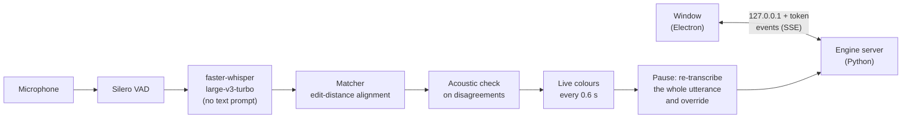

<div align="center">

# ReciteFlow

**Recite a whole paragraph from memory. The app follows along word by word and marks every mistake.**


</div>

---

## What it does

You paste a text, press **Start**, and recite it from memory. Each word is coloured about a second after you say it:

| Colour | Meaning |
|---|---|
| green | correct |
| red | wrong word |
| red `[missed]` | a word you skipped |
| red `{extra}` | a word you added |
| amber | misspelled / mispronounced |
| grey | not said yet |

The goal is "nearly perfect", **proven by benchmarks, not by feel**. The metric that matters most is *hidden mistakes*:
a spoken mistake that the app shows as correct.

## Features

- **Live word-by-word feedback**: median ~1.2 s after each word.
- **Reciting from memory**: hide the text until each word is said, and beep on a mistake so you can recite with your
  eyes closed.
- **Re-recite**: go back (to the start of the sentence, up to 25 words) and say it again. The mistake stays red and is
  underlined.
- **Correct the app**: after a recitation, click any word the app got wrong. Corrections are saved as labels for
  future fine-tuning.
- **History**: every recitation is stored locally (SQLite) with its recording, if you allow it.
- **Light and dark themes.**
- **Local-first**: runs on your own GPU, nothing leaves your machine.

## How it works



The window is Electron (plain HTML, CSS and JavaScript). The recognition engine is Python and runs as a local
sidecar: the window starts it, talks to it on `127.0.0.1` with a random token, and restarts it if it stops. The engine
reads the microphone itself, so Whisper hears the raw audio.

1. **VAD** (Silero) finds speech and pauses.
2. **Whisper transcribes without being shown your text.** Giving Whisper the target text made it "hear" the text and
   hide real mistakes (you say "six", it writes "ten").
3. The **matcher** aligns what was heard to the target text (correct / misspelled / wrong / missed / extra).
4. When the two disagree, an **acoustic check** scores the target word against the heard word on the audio itself,
   so a Whisper guess cannot hide a mistake.
5. Live passes use LocalAgreement-2 (a word is shown once two passes agree). At each pause the whole utterance is
   re-checked and overrides the live colours.

## Results

Measured on a practice set of 152 spoken mistakes (TTS) and public LibriSpeech clips.

| Setup | Hidden mistakes (of 152) | False alarms |
|---|---|---|
| Text given to Whisper as a prompt | 15 | 15 |
| No prompt + acoustic check, per pause | 4 | 27 |
| Live, no re-align | 4 | 70 |
| **Live + re-align at pauses (default)** | **4** | **28** |

- LibriSpeech: 39-40 / 40 short and 23-24 / 24 long injected mistakes caught.
- Final exam on real recordings never used for tuning: every known mistake caught, none hidden.
- Live latency on 75 clips replayed in real time: median 1.18 s, p90 1.47 s per word; pause override median 1.10 s.
  About 1.5-1.8 GB VRAM.

## Getting started

**Requirements:** Windows, Node.js 24, Python 3.12, an NVIDIA GPU (developed on an RTX 4050, 6 GB), and a
microphone. CUDA libraries come from pip, so no system CUDA install is needed.

```bash
git clone https://github.com/yassinemaazaoui114-git/ReciteFlow.git
cd ReciteFlow
npm install
py -3.12 -m pip install -r engine/requirements.txt
npm start
```

The Whisper model is downloaded on first run into `~/.cache/huggingface/hub`.

### Tests

```bash
cd engine
py -3.12 -m pytest -q          # engine tests
py -3.12 check_server.py       # drives the engine server like the window does (needs the GPU)
```

## Project layout

```
src/main/         window, starts and restarts the engine
src/preload/      the few named calls the page may use (no Node in the page)
src/renderer/     the page; design/ = design system (tokens, components)
engine/server.py  local server: routes and events
engine/recite.py  recitation logic, no UI
engine/asr/       mic/WAV, Silero VAD, faster-whisper engine, acoustic check, live passes
engine/matcher/   normalisation + word alignment
engine/core/      UI-free session logic, SQLite history + corrections
engine/tools/     benchmarks
```

## Status and roadmap

The engine and the engine server are built and tested. The screens are in progress.

## Privacy

Recordings and history stay on your machine and are not part of this repository.

## License

[MIT](LICENSE)
