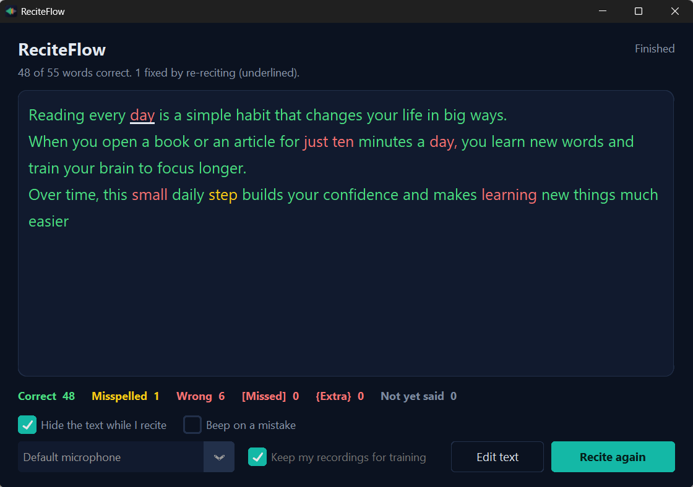
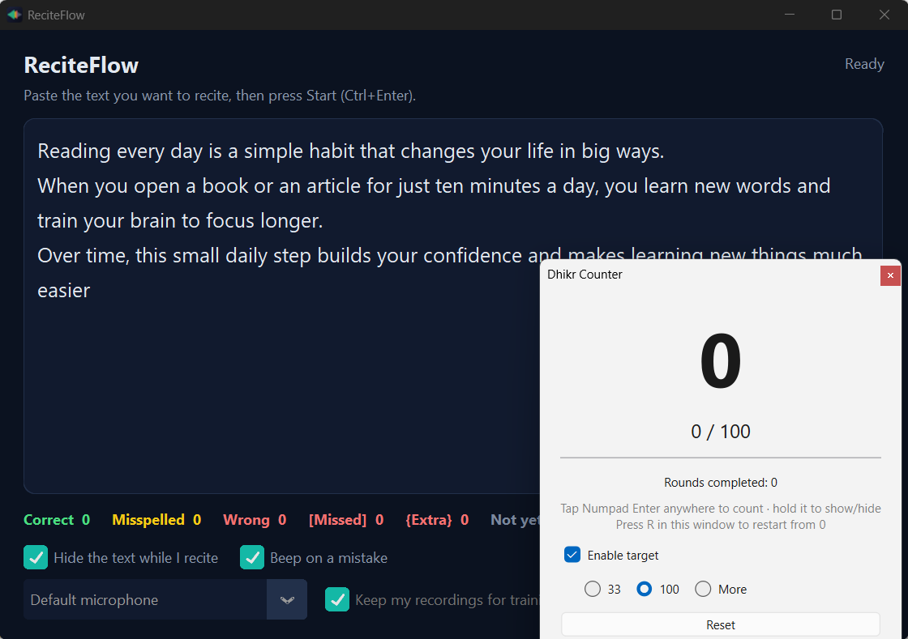
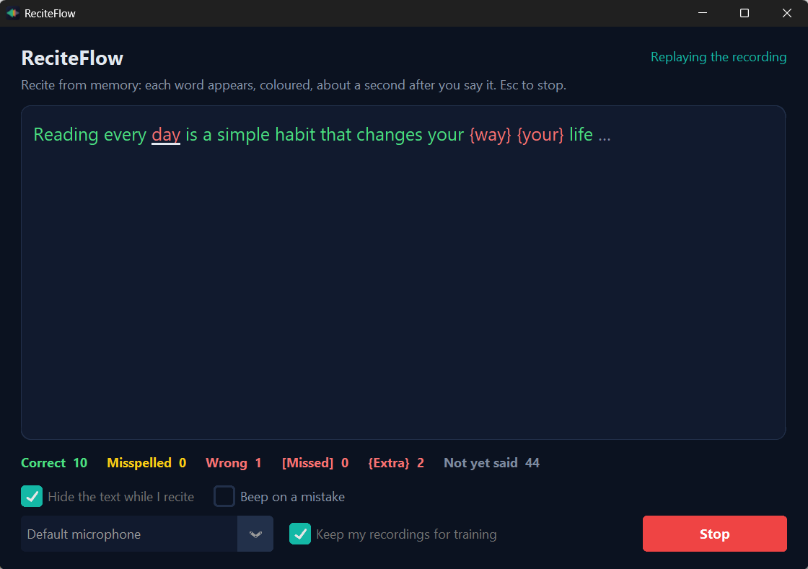
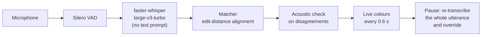

<div align="center">

# ReciteFlow

**Recite a whole paragraph from memory. The app follows along word by word and marks every mistake.**




</div>

---

## What it does

You paste a text, press **Start**, and recite it from memory. Each word is coloured about a second after you say it:

| Colour | Meaning |
|---|---|
| 🟢 green | correct |
| 🔴 red | wrong word |
| 🔴 red `[missed]` | a word you skipped |
| 🔴 red `{extra}` | a word you added |
| 🟡 yellow | misspelled / mispronounced |
| ⚪ grey | not said yet |

The goal is "nearly perfect", **proven by benchmarks, not by feel**. The metric that matters most is *hidden mistakes*:
a spoken mistake that the app shows as correct.

## Screenshots

<table>
<tr>
<td width="50%"><br><sub><b>1. Paste the text</b>, then press Start (Ctrl+Enter).</sub></td>
<td width="50%"><br><sub><b>2. Recite.</b> Words appear, coloured, as you say them. The text stays hidden until said.</sub></td>
</tr>
</table>

## Features

- **Live word-by-word feedback**: median ~1.3 s after each word.
- **Reciting from memory**: hide the text until each word is said, and beep on a mistake so you can recite with your eyes closed.
- **Re-recite**: go back (to the start of the sentence, up to 25 words) and say it again. The mistake stays red and is underlined.
- **Correct the app**: after a recitation, click any word the app got wrong. Corrections are saved as labels for future fine-tuning.
- **History**: every recitation is stored locally (SQLite) with its recording, if you allow it.
- **Local-first**: runs on your own GPU, nothing leaves your machine.

## How it works



1. **VAD** (Silero) finds speech and pauses.
2. **Whisper transcribes without being shown your text.** Giving Whisper the target text made it "hear" the text and hide real mistakes (you say "six", it writes "ten").
3. The **matcher** aligns what was heard to the target text (correct / misspelled / wrong / missed / extra).
4. When the two disagree, an **acoustic check** scores the target word against the heard word on the audio itself, so a Whisper guess cannot hide a mistake.
5. Live passes use LocalAgreement-2 (a word is shown once two passes agree). At each pause the whole utterance is re-checked and overrides the live colours.

## Results

Measured on a practice set of 152 spoken mistakes (TTS) and public LibriSpeech clips.

| Setup | Hidden mistakes (of 152) | False alarms |
|---|---|---|
| Text given to Whisper as a prompt (old) | 15 | 15 |
| No prompt + acoustic check, per pause | 4 | 27 |
| Live, no re-align | 4 | 70 |
| **Live + re-align at pauses (default)** | **4** | **28** |

- LibriSpeech: 39-40 / 40 short and 23-24 / 24 long injected mistakes caught.
- Final exam on real recordings never used for tuning: every known mistake caught, none hidden.
- Live latency: median ~1.3 s, p90 ~1.6 s per word; pause override ~1.4 s. About 1.5 GB VRAM.

Full decision log and benchmarks: [`SPEC.md`](SPEC.md).

## Getting started

**Requirements:** Windows, Python 3.12, an NVIDIA GPU (developed on an RTX 4050, 6 GB), and a microphone.
CUDA libraries come from pip, so no system CUDA install is needed.

```bash
git clone https://github.com/yassinemaazaoui114-git/ReciteFlow.git
cd ReciteFlow
python -m venv .venv
.venv\Scripts\activate
pip install -r requirements.txt
```

The Whisper model is downloaded on first run into `~/.cache/huggingface/hub`.

### Run

```bash
python gui.py                                   # window app: paste text, Start / Stop
python reciteflow.py --file my_text.txt         # terminal app
python reciteflow.py --list-devices             # pick a microphone, then --device N
```

Replay a recording instead of using the microphone (for testing):

```bash
python gui.py --file text.txt --wav recording.wav
python reciteflow.py --file text.txt --wav recording.wav --realtime
```

### Tests

```bash
python -m pytest -q
```

## Project layout

```
gui.py            window app (CustomTkinter)
reciteflow.py     terminal app
matcher/          normalisation + word alignment
asr/              mic/WAV, Silero VAD, faster-whisper engine, acoustic check, live passes
core/             UI-free session logic, SQLite history + corrections
tools/            benchmarks, clip recording, TTS mistake generation, error analysis
tests/            pytest suite
SPEC.md           requirements, architecture, benchmarks, decision log
```

`core/session.py` has no UI code, so the terminal app and the window app share it.

## Status and roadmap

The engine and both apps work and are tested. Next:

- [ ] Fix a re-recited mistake that is shown as correct (matcher)
- [ ] GUI polish
- [ ] Benchmark streaming-first ASR models against Whisper live
- [ ] Packaged installer
- [ ] Arabic memorization checker

## Privacy

Recordings and history stay on your machine in `data/` and are not part of this repository.
