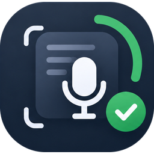
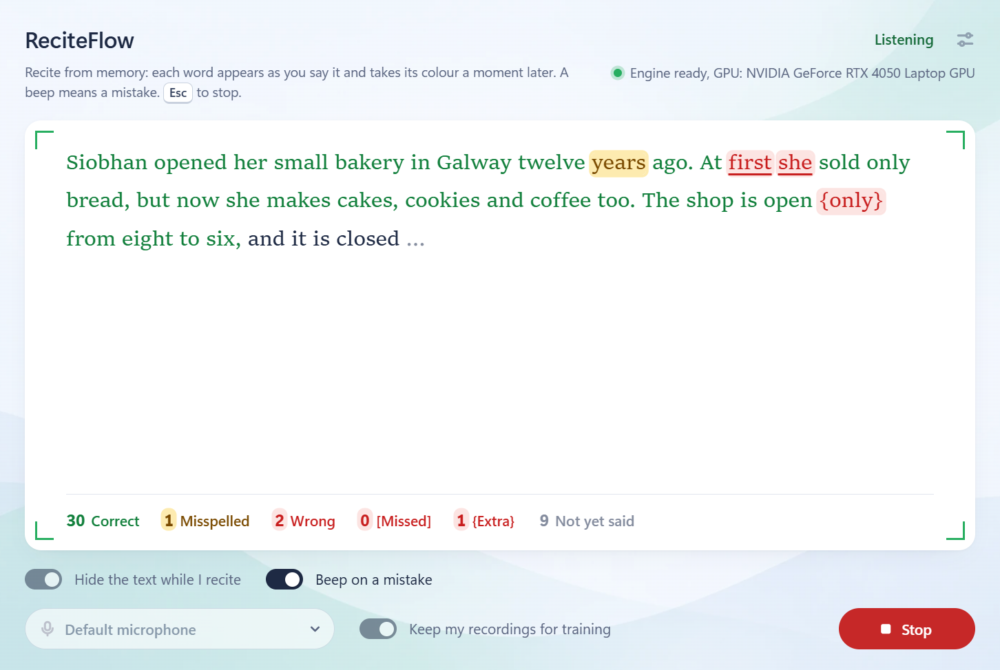
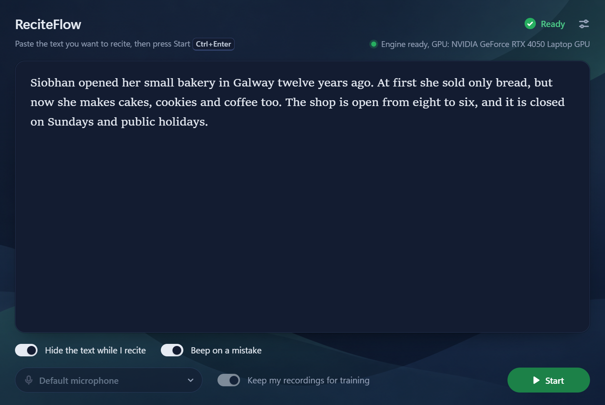
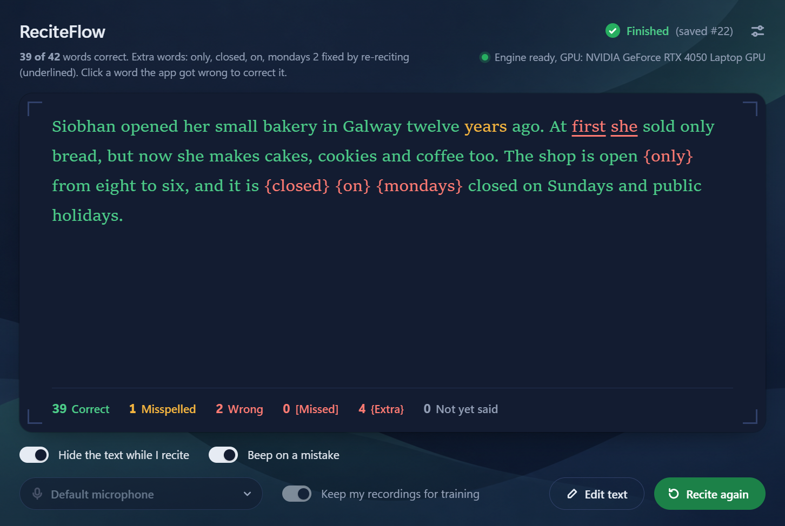
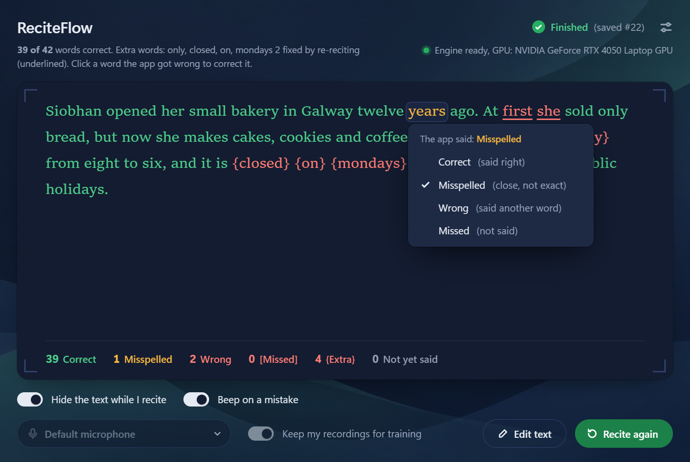
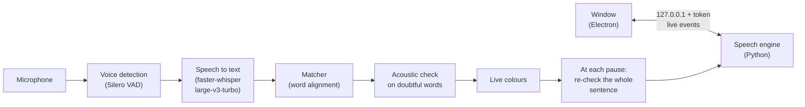

<div align="center">



# ReciteFlow

**Learn a text by heart and recite it out loud. ReciteFlow listens, follows you word by word,
and shows every mistake the moment you make it.**




</div>

---

## Contents

- [What is ReciteFlow?](#what-is-reciteflow)
- [What the colours mean](#what-the-colours-mean)
- [Screenshots](#screenshots)
- [Features](#features)
- [Install](#install)
- [How to use it](#how-to-use-it)
- [Privacy](#privacy)
- [How it works](#how-it-works)
- [Accuracy](#accuracy)
- [Troubleshooting](#troubleshooting)
- [For developers](#for-developers)
- [License](#license)

## What is ReciteFlow?

When you memorise a paragraph (a speech, a poem, a lesson, an exam answer), the hard part is checking yourself.
Reading it back afterwards is slow, and it is easy to miss a skipped or swapped word.

ReciteFlow does the checking for you:

1. **Paste** the text you want to learn.
2. **Press Start** and recite it from memory, out loud, into your microphone.
3. **Watch** each word appear as you say it, coloured by whether you said it right. A short beep tells you the moment
   you make a mistake, so you can even recite with your eyes closed.
4. **Review** the result: how many words were correct, which ones you missed, swapped or added.

Everything runs on your own computer. Your voice is never sent to the internet.

## What the colours mean

| You see | Meaning |
|---|---|
| green word | Correct: you said it right |
| yellow word | Misspelled: close, but not exactly the word (for example *year* instead of *years*) |
| red word | Wrong: you said a different word |
| red `[word]` | Missed: you skipped this word |
| red `{word}` | Extra: you said a word that is not in the text |
| grey word | Not said yet |
| <ins>underlined</ins> word | You went back and recited it again, correctly this time (the mistake still counts) |

The counters under the text (Correct, Misspelled, Wrong, Missed, Extra, Not yet said) are also the legend.

## Screenshots

<table>
  <tr>
    <td width="50%"></td>
    <td width="50%"></td>
  </tr>
  <tr>
    <td align="center"><b>1. Paste your text</b><br/>Choose the microphone and options, then press Start.</td>
    <td align="center"><b>2. See the result</b><br/>The whole text, coloured, with a one-line summary.</td>
  </tr>
  <tr>
    <td width="50%"></td>
    <td width="50%"></td>
  </tr>
  <tr>
    <td align="center"><b>While you recite</b><br/>With "Hide the text" on, only the words you have said appear.</td>
    <td align="center"><b>Correct the app</b><br/>Click a word it got wrong and pick what you really said.</td>
  </tr>
</table>

Light and dark themes are both built in (Settings, top right: Windows, Light or Dark).

## Features

- **Live, word-by-word feedback.** A word appears about half a second after you say it and takes its colour about a
  second after you say it.
- **Recite from memory.** "Hide the text while I recite" keeps the text hidden; each word shows up only once you
  have said it, so you cannot peek.
- **A beep on each mistake.** Turn on "Beep on a mistake" to hear a short tone the moment you go wrong. You can turn it
  off at any time, even while reciting.
- **Go back and fix it.** Noticed a mistake? Go back (up to the start of the sentence) and say it again. The word is
  shown as fixed (underlined) but still counted as a mistake, so the score stays honest.
- **Correct the app.** After a recitation, click any word the app judged wrongly and choose what you really said. The
  counters and the summary update at once, and your correction is saved.
- **History.** Every recitation from the microphone is saved on your computer, with its result. With "Keep my
  recordings for training" on, the audio is kept too.
- **Open a text file or a photo.** Take a picture of a book page and ReciteFlow reads its words (on your computer,
  without the graphics card), then lets you pick the part to recite.
- **Light and dark themes**, following Windows by default.
- **Keyboard friendly.** <kbd>Ctrl</kbd>+<kbd>Enter</kbd> starts, <kbd>Esc</kbd> stops, and words can be corrected
  without a mouse.
- **Private by design.** Speech recognition runs on your own graphics card. Nothing is uploaded.
- **Stays responsive.** If the speech engine ever stops responding, ReciteFlow tells you in plain words and restarts it
  by itself.

## Install

### What you need

| | |
|---|---|
| **System** | Windows (tested on Windows 11) |
| **Graphics card** | An NVIDIA GPU (tested on an RTX 4050 with 6 GB; ReciteFlow uses about 1.5 GB of it while you recite) |
| **Microphone** | Any microphone; a headset gives the best results |
| **Software** | [Node.js 24](https://nodejs.org/) and [Python 3.12](https://www.python.org/downloads/) |
| **Disk space** | About 5 GB (the speech model is 1.6 GB, plus the Python packages) |

You do **not** need to install CUDA yourself: the GPU libraries come with the Python packages.

### Steps

Open a terminal (for example *Windows Terminal* or *PowerShell*) and run:

```bash
git clone https://github.com/yassinemaazaoui114-git/ReciteFlow.git
cd ReciteFlow
npm install
py -3.12 -m pip install -r engine/requirements.txt
npm start
```

The first start downloads the speech model (about 1.6 GB, once). After that, ReciteFlow is ready a few seconds after
it opens: the top right corner says **Ready** and **Engine ready** with the name of your graphics card.

To start it again later, open a terminal in the `ReciteFlow` folder and run `npm start`.

## How to use it

1. **Paste your text** into the big box. Line breaks are kept. Or click **Open a file** (<kbd>Ctrl</kbd>+<kbd>O</kbd>)
   and pick a `.txt` file or a photo of a page (JPG, PNG, HEIC, WebP...). A window shows the text found: fix any
   misread word, then select the part you want and press *Use this part*, or press *Take it all*.
2. **Pick your microphone** in the list at the bottom left (or leave *Default microphone*).
3. **Choose your options:**
   - *Hide the text while I recite*: on, to really test your memory.
   - *Beep on a mistake*: on, to hear each mistake as it happens.
   - *Keep my recordings for training*: on, to keep the audio of each recitation on your computer.
4. **Press Start** (or <kbd>Ctrl</kbd>+<kbd>Enter</kbd>) and begin reciting. Speak normally; you can pause to think.
5. **Press Stop** (or <kbd>Esc</kbd>) when you are done. ReciteFlow checks the last words, then shows the result.
   If you recite the whole text, it finishes by itself.
6. **Read the result.** The top line says, for example, *39 of 42 words correct*, and lists any extra words.
7. **Fix the app if needed.** If the app marked a word wrongly, click it and choose what you really said. Click
   *Undo my correction* in the same menu to take it back.
8. **Try again** with *Recite again*, or change the text with *Edit text*.

**Tips**

- Recite in a quiet room, at a normal pace. Very fast or mumbled speech is harder to follow.
- If you stumble, simply go back to the start of the sentence and say it again.
- Long texts are fine: the page scrolls by itself to follow you.

## Privacy

- Your voice is processed **only on your computer**, by your own graphics card.
- Recitations are saved **only on your computer**. Recordings are kept only if you turn on *Keep my recordings for
  training*.
- Photos you open are read on your computer too (the text-reading models come with the Python packages).
- The only network access is the one-time download of the speech model.
- ReciteFlow's window talks to its speech engine on your own machine only (`127.0.0.1`, with a random key), so nothing
  can reach it from outside.

## How it works

ReciteFlow has two parts: the **window** (Electron: HTML, CSS and JavaScript) and the **speech engine** (Python),
which the window starts in the background, watches, and restarts if needed.



1. **Voice detection** (Silero VAD) finds where you speak and where you pause.
2. **Speech to text** (faster-whisper, model *large-v3-turbo*, on the GPU) writes down what you said, **without being
   shown your text**. When the speech model is given the expected text, it tends to "hear" the text and hide real
   mistakes (you say *six*, it writes *ten*). ReciteFlow never does that.
3. The **matcher** lines up what was heard with your text, word by word: correct, misspelled, wrong, missed or extra.
4. When the two disagree, an **acoustic check** compares your text's word with the heard word on the audio itself, so
   a guess by the speech model cannot hide a mistake.
5. **Live colours**: short passes run while you speak, and a word is coloured once two passes agree on it. At each
   pause, the whole sentence is checked again and its colours are corrected if needed.

## Accuracy

The most important number is **hidden mistakes**: a mistake you made that the app shows as correct. Then **false
alarms**: a correct word shown as a mistake.

Measured on a practice set with 152 spoken mistakes:

| Setup | Hidden mistakes (of 152) | False alarms |
|---|---|---|
| Text given to the speech model as a hint | 15 | 15 |
| No hint + acoustic check, at each pause | 4 | 27 |
| Live colours only | 4 | 70 |
| **Live colours + re-check at each pause (what ReciteFlow uses)** | **4** | **28** |

- Public LibriSpeech recordings with mistakes added: 39-40 of 40 caught on short clips, 23-24 of 24 on long ones.
- Real recordings never used for tuning: every known mistake caught, none hidden.
- Speed, on 75 recordings replayed in real time: a word is coloured a median of 1.18 s after it is said (90 % within
  1.47 s); the re-check at a pause lands about 1.1 s after you stop.

## Troubleshooting

| Problem | What to do |
|---|---|
| *Start* stays grey | The speech model is still loading; wait for **Ready** at the top right. The first start also downloads the model. |
| "Could not load the speech model" | Check that you have an NVIDIA graphics card and an up-to-date driver, then click *Start again*. Close other programs that use a lot of GPU memory. |
| "The engine stopped..." message | ReciteFlow restarts the engine by itself; wait for **Ready**. The recitation in progress is not saved. |
| No words appear while I speak | Check that the right microphone is selected and that Windows lets apps use it (*Settings > Privacy > Microphone*). |
| A photo gives wrong or missing words | Take the photo straight on, in good light, with the page filling most of the picture; fix the remaining words in the window before *Take it all*. |
| Many words marked wrong | Speak a little slower and closer to the microphone, and reduce background noise. Click a word to correct the app if it misheard you. |
| `py` is not recognised | Install Python 3.12 from python.org with the *py launcher* option ticked. |

## For developers

### Project layout

```
src/main/          the window's main process: opens the window, starts and restarts the engine
src/preload/       the few named calls the page may use (the page has no Node access)
src/renderer/      the page; design/ holds the design system (tokens, components, word colours)
engine/server.py   local server: routes and live events (server-sent events)
engine/recite.py   the recitation logic, no user interface
engine/read_text.py  reads an opened .txt or photo (RapidOCR, on the CPU) for the text box
engine/asr/        microphone and WAV input, Silero VAD, faster-whisper, acoustic check, live passes
engine/matcher/    text normalisation and word alignment
engine/core/       session logic, history (SQLite) and corrections
engine/tools/      accuracy and latency benchmarks
engine/tests/      engine tests
```

### Tests

```bash
cd engine
py -3.12 -m pytest -q        # engine tests (no GPU needed)
py -3.12 check_server.py     # drives the engine server like the window does (needs the GPU)
```

The window has built-in checks too, run with `RECITEFLOW_SELFTEST=<name> npm start` (for example `recite`,
`correct`, `polish`, `stall`); see `src/main/`.

### Replaying a recording instead of the microphone

For testing, `RECITEFLOW_FILE=<text.txt>` fills the text box and `RECITEFLOW_WAV=<recording.wav>` replays a recording
in real time instead of using the microphone (replays are not saved).

## License

[MIT](LICENSE)
